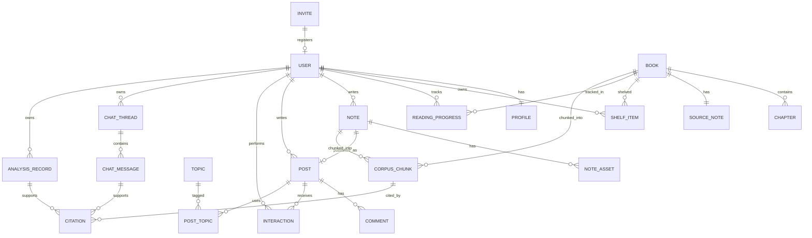
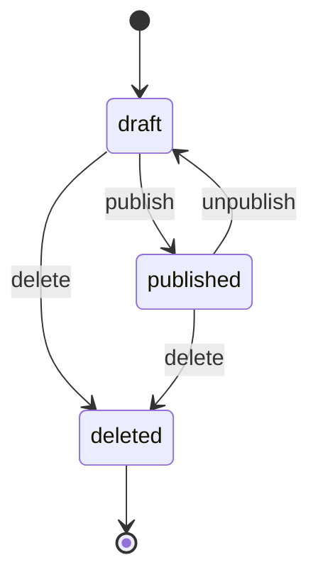
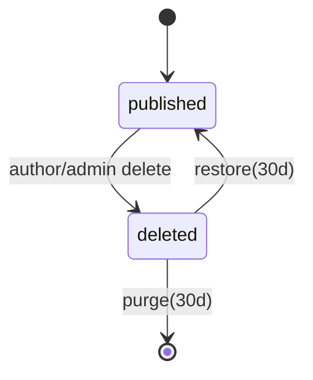
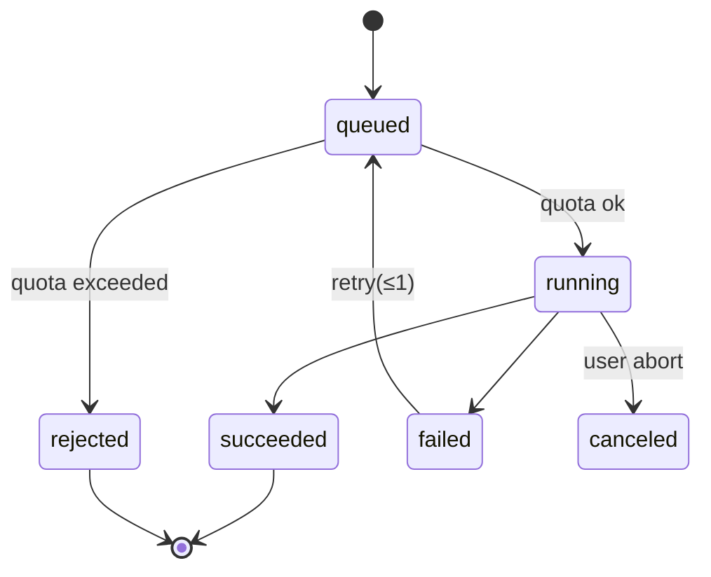
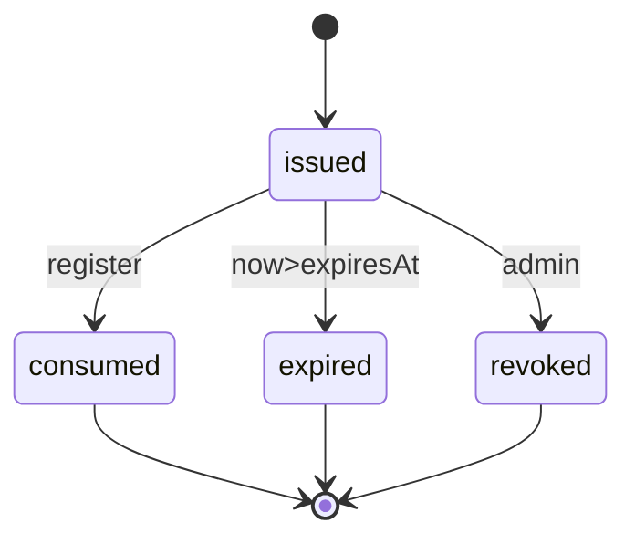
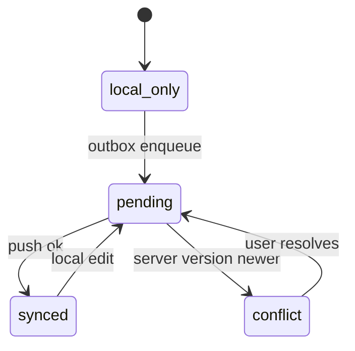

# 领域模型（Domain Model）

| 项目 | 内容 |
|---|---|
| 版本 | v1.0 |
| 日期 | 2026-11-27 |
| 输入 | `docs/requirements/REQUIREMENTS.md` v1.0（Q1–Q8 已确认） |
| 输出 | 限界上下文、聚合、不变量、状态机、用例、容量模型、与现状的差距 |
| 状态 | 已评审：D1/D2/D4/D5 采纳；设计见 [`docs/design/`](../design/) |

---

## 1. 建模目标与边界

本次建模回答四个问题：

1. 系统里到底有哪些**概念**，它们之间的关系是什么；
2. 哪些规则是**必须永远成立**的（不变量），由谁来保证；
3. 哪些对象有**生命周期**（状态机），状态如何迁移；
4. 当前代码与目标模型差在哪，改造顺序是什么。

约束由需求确认：**邀请制 ≤50 活跃用户、单实例、先本地后云端、内容只用公版/授权摘录、AI 按量付费且有配额、部署在腾讯云宝塔、本地不加密**。

## 2. 统一语言（Ubiquitous Language）

| 术语 | 英文 | 定义 | 易混淆点 |
|---|---|---|---|
| 书 | Book | 一部可阅读的作品，含元数据与来源 | 不等于章节 |
| 章节 | Chapter | 书的有序片段，阅读的最小单位 | 顺序必须稳定 |
| 来源 | SourceNote | 书的版权/出处/许可与署名 | 不是引用（Citation） |
| 书架项 | ShelfItem | 用户把某本书加入自己的书架 | 不是收藏（Collect） |
| 阅读进度 | ReadingProgress | 某用户在某本书上的位置（章节 + 百分比） | 不是阅读时长 |
| 阅读会话 | ReadingSession | 一次连续阅读的时间段，用于统计时长 | 可合并/截断 |
| 笔记 | Note | 用户创作的内容，可关联书/章节/摘录 | 草稿与已发布 |
| 帖子 | Post | 社区可见内容，来源可以是原创或笔记发布 | 不是笔记本身 |
| 评论 | Comment | 挂在帖子下的讨论，可楼中楼 | 不挂在笔记上 |
| 互动 | Interaction | 点赞/收藏，唯一键 (user, kind, target) | 不是浏览 |
| 话题 | Topic | 帖子/笔记的分类标签 | 名称不含重复 # |
| AI 会话 | ChatThread | 一次连续对话 | 不是单条消息 |
| 赏析记录 | AnalysisRecord | 对某段文本的结构化赏析结果 | 不是聊天消息 |
| 语料块 | CorpusChunk | 供检索的文本片段（书/笔记） | 不是章节本身 |
| 引用 | Citation | RAG 回答中指向语料块的证据 | 必须可回溯 |
| 邀请 | Invite | 注册凭证，一次性/可过期 | 不是用户 |
| 审计日志 | AuditLog | 关键管理操作留痕 | 不是应用日志 |

## 3. 限界上下文（Bounded Contexts）

| 上下文 | 职责 | 拥有的数据 | 对外暴露 |
|---|---|---|---|
| **Identity** | 邀请、注册、登录、角色、资料 | User/Profile/Invite/Role | 当前用户、权限判断 |
| **Library** | 书、章节、来源与许可 | Book/Chapter/SourceNote | 书库查询、章节内容 |
| **Reading** | 书架、进度、书签、生词、时长 | ShelfItem/ReadingProgress/ReadingSession/Bookmark/VocabItem | 阅读状态与统计 |
| **Writing** | 笔记的创建、编辑、发布 | Note/NoteAsset/NoteSource | 笔记 CRUD、发布事件 |
| **Community** | 帖子、评论、话题、互动、举报 | Post/Comment/Topic/Interaction/Report | 社区信息流与互动 |
| **Assistant** | 赏析、问答、RAG、配额 | ChatThread/ChatMessage/AnalysisRecord/AIRequest/CorpusChunk/Citation | AI 能力与用量 |
| **Data** | 本地持久化、迁移、备份、同步 | Snapshot/Migration/Backup/Outbox | 读写接口、迁移与备份 |
| **Admin** | 邀请管理、内容治理、审计 | ModerationRule/AuditLog | 管理操作 |

上下文之间的依赖方向（单向，禁止反向）：

```text
Identity ──► Community ──► Assistant
   │            ▲             ▲
   ▼            │             │
Writing ────────┘             │
   │                          │
   ▼                          │
Library ──► Reading ──────────┘
Data（被所有上下文依赖，但不依赖任何业务上下文）
```

## 4. 聚合与一致性边界

聚合根负责保证其内部不变量；跨聚合只能通过 id 引用与最终一致（或应用层事务）协作。

| 聚合根 | 内部实体/值对象 | 一致性要求 |
|---|---|---|
| **User** | Profile、Roles | 资料与角色同事务；id 与 auth.uid 一致 |
| **Book** | Chapter[]、SourceNote | 章节顺序与内容同事务；来源必填 |
| **Note** | NoteSource、NoteAsset[] | 状态迁移与发布事件一致 |
| **Post** | PostTopic[] | 发布时话题存在或创建 |
| **Comment** | —— | parentId 必须属于同一 Post |
| **Interaction** | —— | (user,kind,target) 唯一 |
| **ChatThread** | ChatMessage[] | 消息追加与 thread.updatedAt 一致 |
| **ReadingProgress** | —— | (user,book) 唯一，进度 0–1 |
| **Invite** | —— | 一次性使用；使用与用户创建同事务 |
| **AIRequest** | —— | 配额扣减与请求创建同事务；失败不计成功用量 |

**计数（likes/comments/views/notesCount…）**：

- 读多写少，采用**反规范化计数**，与记录变更在同一事务内更新；
- 每日对账任务重算并修正漂移（对数），漂移超过阈值告警；
- 禁止在 UI 层做 ±1。

## 5. 关系模型（概念层）



### 5.1 核心实体字段（概念级，物理表在设计阶段确定）

| 实体 | 关键字段 | 约束 |
|---|---|---|
| User | id, email, status(active/pending/suspended), roles | id 与 auth.uid 一致；≤50 active |
| Invite | code, createdBy, expiresAt, usedBy, usedAt | 一次性；过期不可用 |
| Book | id, title, author, category, difficulty, language, coverAssetId | 来源必填 |
| SourceNote | bookId, type(public-domain/authorized/excerpt), title, license, url, attribution | type∈枚举；attribution 非空 |
| Chapter | id, bookId, index, title, content | (bookId,index) 唯一且连续 |
| ShelfItem | userId, bookId, addedAt | (userId,bookId) 唯一 |
| ReadingProgress | userId, bookId, chapterId, percent, updatedAt | percent∈[0,1]；(userId,bookId) 唯一 |
| ReadingSession | userId, bookId, startedAt, endedAt, seconds | endedAt>startedAt |
| Note | id, authorId, title, content, status, template, sourceBookId, sourceChapterId, excerpt, publishedPostId | status∈{draft,published,deleted} |
| NoteAsset | id, noteId, kind(image/cover), storageRef, width, height, bytes | 不计入正文 |
| Post | id, authorId, kind(original/note), noteId?, title, content, deletedAt, createdAt | kind=note 时 noteId 必填 |
| Comment | id, postId, authorId, parentId?, content, deletedAt | parent 同 postId；层级 ≤3 |
| Topic | id, name(normalized) | name 唯一 |
| Interaction | id, userId, kind(like/collect), targetType(post), targetId | (userId,kind,targetType,targetId) 唯一 |
| ChatThread | id, userId, title, updatedAt | —— |
| ChatMessage | id, threadId, role(user/assistant), content, citations[] | 失败消息不落库 |
| AnalysisRecord | id, userId, bookId, chapterId, textHash, analysisJson, model, latencyMs | 仅成功结果 |
| AIRequest | id, userId, kind(analyze/chat/embed/translate), tokensIn, tokensOut, status, latencyMs, createdAt | 用于配额与成本 |
| CorpusChunk | id, sourceType(book/note), sourceId, ordinal, text, hash, embedding?, updatedAt | (sourceType,sourceId,ordinal) 唯一 |
| Citation | id, ownerType(message/analysis), ownerId, chunkId, quote, score | quote 必须来自 chunk |
| AuditLog | id, actorId, action, target, payload, createdAt | 只追加 |

## 6. 不变量（必须永远成立）

| ID | 规则 | 保证方式 | 测试 |
|---|---|---|---|
| INV-01 | 活跃用户 ≤50 | 注册事务内计数 + 拒绝 | 单测：第 51 个失败 |
| INV-02 | 邀请码一次性、可过期 | 事务内 usedBy 条件更新 | 并发使用同一码只成功一次 |
| INV-03 | 每本书必须有来源与许可 | 数据库非空 + 服务校验 | 迁移/创建用例 |
| INV-04 | 章节 index 连续且唯一 | (bookId,index) 唯一 + 写入校验 | 重排测试 |
| INV-05 | 进度 ∈[0,1]，每用户每书一条 | 约束 + upsert | 边界值测试 |
| INV-06 | 笔记状态只能 draft→published→deleted | 状态机校验 | 非法迁移被拒 |
| INV-07 | 笔记发布后对应 Post 唯一且 kind=note | 唯一索引 publishedPostId | 重复发布幂等 |
| INV-08 | 互动唯一 | 唯一索引 | 重复点赞不重复计数 |
| INV-09 | 计数与记录一致 | 同事务更新 + 每日对账 | 对账脚本 |
| INV-10 | 评论父级同帖、层级 ≤3 | 服务校验 | 构造非法父级 |
| INV-11 | 删除为软删，30 天后硬删 | deletedAt + 清理任务 | 恢复测试 |
| INV-12 | AI 仅成功结果入库；失败可重试 | 状态机 + 事务 | 注入失败 |
| INV-13 | RAG 回答必须带引用或明确“未检索到” | 输出校验 | 黄金集 |
| INV-14 | AI 配额按用户/日扣减，失败不扣成功量 | 事务 + 用量表 | 并发打满 |
| INV-15 | 非管理员不能修改他人内容 | 服务端鉴权（RLS/中间件） | 越权测试 |
| INV-16 | 破坏性操作前必须备份 | 迁移/导入流程强制 | 迁移失败回滚 |

## 7. 状态机

### 7.1 笔记


规则：发布时若已有 `publishedPostId` 则复用（幂等）；取消发布时帖子软删；删除笔记时帖子一并软删。

### 7.2 帖子 / 评论



### 7.3 AI 请求



### 7.4 邀请



### 7.5 同步（M2）



## 8. 用例模型

| ID | 用例 | 参与者 | 前置 | 后置 |
|---|---|---|---|---|
| UC-01 | 邀请注册 | 受邀用户 | 邀请有效、活跃数<50 | 创建用户与会话 |
| UC-02 | 登录/登出 | 用户 | —— | 会话建立/清除 |
| UC-03 | 浏览与筛选书库 | 用户 | 已登录 | —— |
| UC-04 | 阅读并记录进度 | 用户 | 书存在 | 进度与时长更新 |
| UC-05 | 写笔记并发布 | 用户 | 已登录 | 笔记 published，帖子唯一 |
| UC-06 | 发帖/评论/互动 | 用户 | 已登录 | 计数与记录一致 |
| UC-07 | AI 赏析并保存 | 用户 | 配额充足 | 成功记录 + 引用（可选） |
| UC-08 | RAG 问答 | 用户 | 索引可用、配额充足 | 流式回答 + 引用 + 用量 |
| UC-09 | 备份/恢复 | 用户/管理员 | —— | 导出可回导；失败不覆盖 |
| UC-10 | 邀请与内容治理 | 管理员 | admin 角色 | 邀请/删除/审计 |
| UC-11 | 数据迁移 | 系统 | 版本落后 | 校验通过，旧数据备份 |
| UC-12 | 部署与健康检查 | 运维 | 服务器可用 | 站点可用，`/healthz` 正常 |

### 8.1 关键流程 A：发布笔记

1. 校验 `status=draft`、标题/正文长度、作者身份；
2. 事务内：`Note.status=published`；若无 `publishedPostId` 则创建 `Post(kind=note, noteId)`；
3. 触发索引任务：把笔记切成 `CorpusChunk`（异步、可重试）；
4. 提交事件：通知关注者（M2 以后）。

### 8.2 关键流程 B：RAG 问答

1. 鉴权 + 配额检查（`AIRequest` 事务扣减）；
2. 查询改写（可选）→ 生成/读取 embedding；
3. 检索 top-k `CorpusChunk`（向量 + 关键词混合，按分数合并）；
4. 组装 prompt：系统约束 + 检索片段（带 id）+ 用户问题 + 最近对话；
5. SSE 流式返回；前端增量渲染，可 Abort；
6. 完成后写入 `ChatMessage` + `Citation[]`；记录 `AIRequest` 用量与延迟；
7. 若未检索到有效片段：回答明确说明，不编造引用。

### 8.3 关键流程 C：数据迁移

1. 读取 schema 版本；
2. 迁移前备份（本地快照/服务端 dump）；
3. 按版本顺序执行纯函数迁移；
4. 校验条数与关键字段；失败则回滚并保留旧数据；
5. 记录 `Migration` 元数据（版本、耗时、条数）。

## 9. 容量与规模假设

| 维度 | 假设 | 设计含义 |
|---|---|---|
| 用户 | ≤50 active（邀请制） | 单实例、单库；无需分片与缓存集群 |
| 书 | 100–300 本，单本 ≤50 章 | 章节可整体缓存；全文检索可用 Postgres FTS |
| 内容 | 5k 笔记、2 万帖子/评论/年 | 分页 + 索引即可；无需搜索引擎 |
| 图片 | 单图压缩后 ≤300KB | 对象存储/本地磁盘；不入数据库 |
| AI | 50 用户 × 20 次/日，单次 ≤3k tokens | 峰值 ~1000 次/日；配额 + 缓存 + 降级 |
| 语料 | 300 书 × 20 块 + 5k 笔记 × 3 块 ≈ 2 万块 | 向量索引单机可承载 |
| 备份 | 每日全量 + 每小时增量（M2） | 站外对象存储；保留 14 天 |

## 10. 与现状的差距（Gap Analysis）

| 目标模型 | 当前实现 | 差距 | 处理 |
|---|---|---|---|
| Post(kind=note) 引用笔记 | 发布笔记时复制内容新建 Post | 双份真相 | M1.5 改为引用，迁移历史数据 |
| 评论只挂 Post | 同左 | 一致 | 保留 |
| 互动只针对 Post | 笔记也可点赞 | 统计口径不一 | M1.5 统一到 Post |
| Book 有 SourceNote | 无来源字段 | 无法标注版权 | M1.5 增加字段 + 清理伪造章节 |
| Invite 邀请制 | 无 | 无法限制 50 人 | M2 实现 |
| CorpusChunk/Citation | 无 | RAG 不可用 | M3 实现 |
| AIRequest 配额 | 无 | 成本不可控 | M3 实现 |
| AuditLog | 无 | 管理操作无痕 | M2/M3 |
| 软删除 | 硬删除 | 误删不可恢复 | M1.5 实现 |
| 计数对账 | 手工维护 | 会漂移 | M1.5 增加对账脚本 |

## 11. 建模决策

| ID | 决策 | 理由 | 代价 |
|---|---|---|---|
| D1 | 笔记发布生成引用型 Post，不复制内容 | 单一真相，编辑不再双写 | 需要迁移历史帖子 |
| D2 | 互动与评论只针对 Post | 统计口径统一；笔记通过发布进入社区 | 笔记列表的点赞数需取 Post 统计 |
| D3 | 计数反规范化 + 每日对账 | 列表性能与可解释性兼顾 | 需要对账任务 |
| D4 | 软删除 + 30 天清理 | 误删可恢复；符合用户预期 | 查询需过滤 deletedAt |
| D5 | RAG 只在云端模式提供 | 本地没有 BFF 与向量服务 | 本地模式明确降级 |
| D6 | 邀请制 + 活跃数硬上限 | 50 人规模与运维成本 | 注册流程多一步 |
| D7 | 不加密本地数据 | 需求 Q8；复杂度收益不匹配 | 依赖设备与账号安全 |
| D8 | 腾讯云 + 宝塔为部署基线 | 需求 Q6；单人可运维 | 需要运维文档与备份脚本 |

## 12. 下一步（设计分析要产出）

1. 物理数据模型：Postgres/IndexedDB 表结构、索引、约束、迁移脚本；
2. 模块与接口契约：`data/repositories/*`、`services/*`、BFF 路由与错误码；
3. 检索设计：切分策略、embedding 模型、混合检索、引用与评测；
4. 配额与成本：计量点、上限、降级与告警；
5. 部署设计：宝塔站点、PM2/Node 项目、环境变量、备份与恢复演练；
6. ADR：笔记/帖子关系、计数策略、RAG 架构、部署形态。